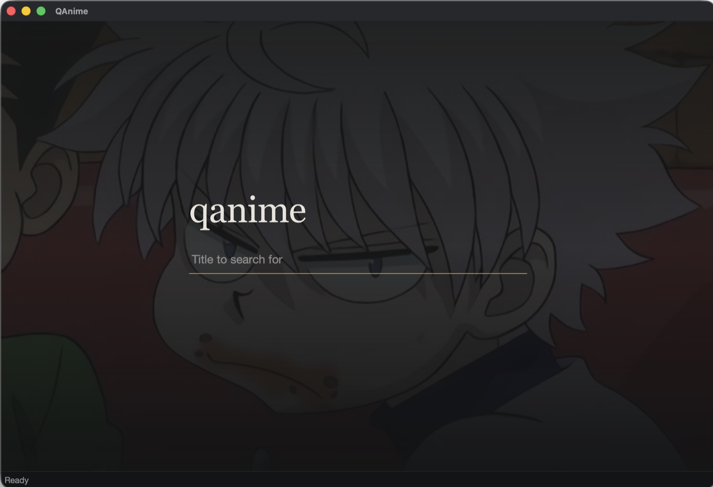
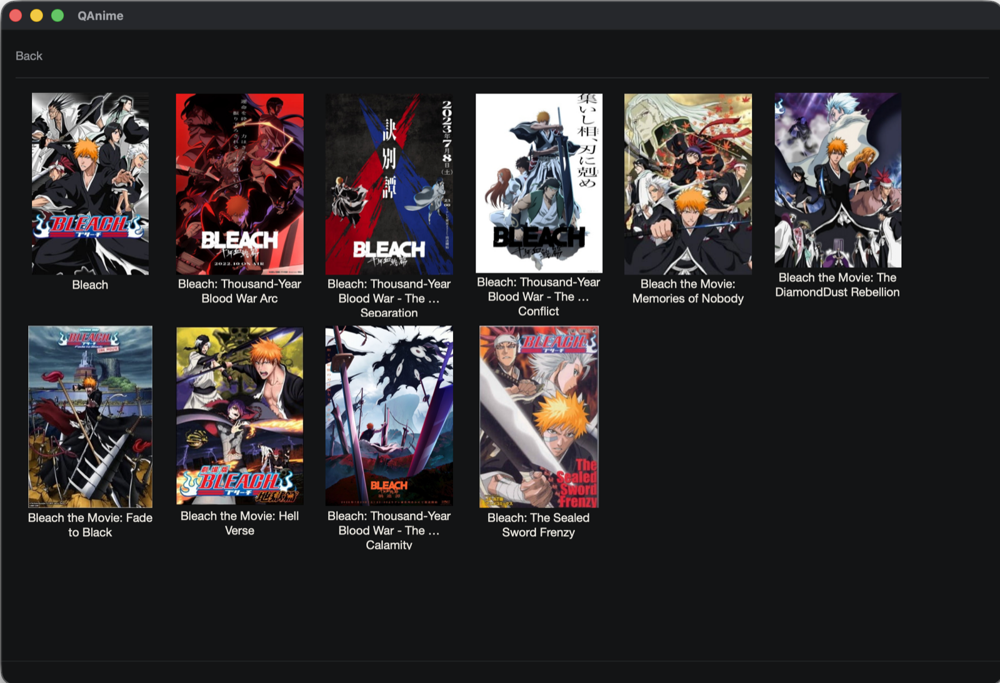
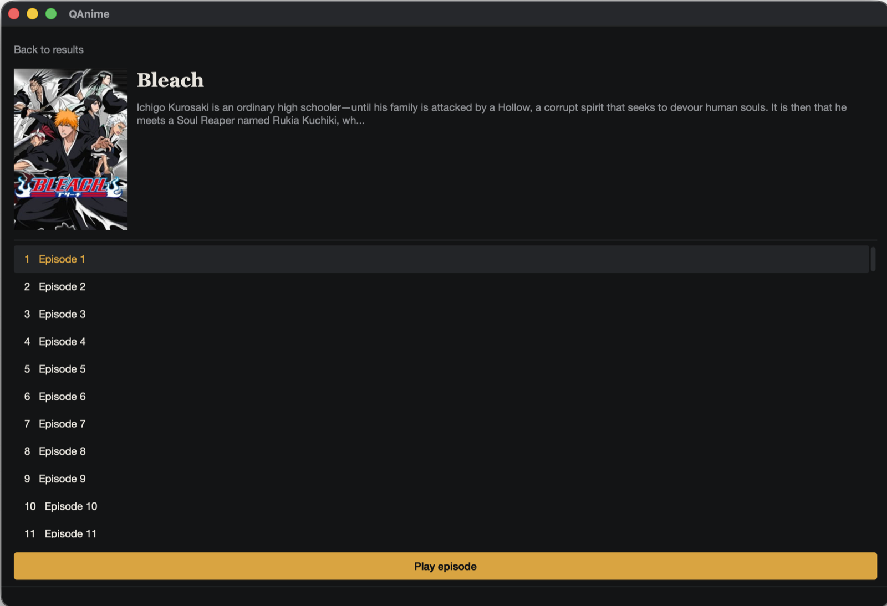

<h1 align="center">qanime</h1>

<p align="center">
  Search for an anime, pick an episode, and watch it in <b>mpv</b>.<br>
  A small desktop app built with Python and Qt, with no browser and no ads.
</p>

<p align="center">
  
  
  
</p>

<p align="center">
  
</p>

> This is a hobby project and hosts no video. Please read the [legal note](#legal--disclaimer) before using or sharing it.

---

## Screenshots

| Results | Episodes |
|---|---|
|  |  |

## Features

- Search by title and browse results as a poster grid
- See the cover and synopsis, then the full episode list
- Double-click an episode to play it in `mpv` (sub)
- Dark UI; network calls run in background threads, so the window never freezes

Inspired by [ani-cli](https://github.com/pystardust/ani-cli).

---

## Quick start

You need Python 3.9+ and [mpv](https://mpv.io/) on your `PATH`.

```bash
git clone https://github.com/Seaniok/QAnime.git
cd QAnime

python -m venv .venv
source .venv/bin/activate        # Windows: .venv\Scripts\Activate.ps1

pip install -r requirements.txt
python -m qanime
```

Install mpv with `brew install mpv` (macOS), `winget install mpv` (Windows) or `sudo apt install mpv` (Linux). Check it with `mpv --version`.

### Using it

1. Type an anime title on the start page and press **Enter**.
2. Click an anime in the results.
3. **Double-click** an episode, or select one and press **Play episode**.
4. mpv opens and plays the stream. If nothing is found, the status bar says `No stream found` or `No m3u8 link`.

---

## How it works

```
┌──────────┐  search   ┌────────────────┐  HTML/JSON   ┌───────────────┐
│  Qt UI   │ ────────► │ anime_scrape.py│ ───────────► │ streaming site│
│(PySide6) │ ◄──────── │(requests + bs4)│ ◄─────────── │(see config.py)│
└────┬─────┘  results  └────────────────┘              └───────────────┘
     │ m3u8 URL + Referer
     ▼
   ┌─────┐
   │ mpv │
   └─────┘
```

1. **Search**: `hianime_search()` requests the site's search page and parses the results with BeautifulSoup into title, link and numeric ID (at most 9 results).
2. **Episodes**: `hianime_episodes()` calls the episode-list endpoint for that ID. The JSON holds an HTML fragment, parsed into `{id, number, title}`.
3. **Servers**: `hianime_download_m3u8()` lists the video servers for the episode, picks `sub` or `dub` (the UI uses `sub`), and base64-decodes the `data-hash` into an embed-page URL.
4. **Stream extraction**: `extract_video_data()` loads the embed page with a matching `Referer`, base64-decodes the obfuscated `window.__P` blob and XOR-decrypts it with a fixed key. The result contains the direct `.m3u8` (HLS) URL.
5. **Playback**: the UI starts `mpv` with the m3u8 URL and a `--http-header-fields=Referer: ...` argument, because the video host rejects requests without it.

Slow steps (search, posters, episodes, resolving the stream) run through `workers.py`, which runs them on a background thread pool and reports back to the window.

### Project layout

```
QAnime/
├── qanime/
│   ├── __main__.py        # entry point: python -m qanime
│   ├── anime_scrape.py    # all scraping and decoding logic
│   ├── config.py          # base URL, endpoints, User-Agent
│   └── qt_ui/
│       ├── main.py        # main window: results, episodes, mpv launch
│       ├── landing.py     # start page with the search box
│       ├── workers.py     # background threads for network calls
│       └── style.qss      # theme
├── resources/             # background image
├── docs/screenshots/      # images used in this README
└── requirements.txt
```

### Configuration

Endpoints and the User-Agent live in `qanime/config.py`:

```python
BASE_API     = "https://hianime.at"
SEARCH_API   = f"{BASE_API}/search?keyword=%s"
EPISODES_API = f"{BASE_API}/api/theme/episode/list/%s"
SERVERS_API  = f"{BASE_API}/api/theme/episode/servers?episodeId=%s"
```

Scrapers depend on a site's exact markup and API. **If the site changes its domain, HTML or encryption, QAnime breaks** until the selectors, endpoints or decoding key are updated. A changed domain only needs `BASE_API` edited.

---

## Troubleshooting

| Problem | Likely cause / fix |
|---|---|
| `mpv not found on PATH` in the status bar | mpv isn't installed or isn't on `PATH` |
| `ModuleNotFoundError` | Run `pip install -r requirements.txt` inside your virtual environment |
| Search returns nothing | Site is down, blocked in your region, or the domain in `config.py` changed |
| `No stream found` / `No m3u8 link` | The server/embed format changed, or that episode has no `sub` stream |
| Video opens but won't play | The Referer or stream host changed; check the embed URL logic |

---

## Credits and inspiration

- **[ani-cli](https://github.com/pystardust/ani-cli)** by pystardust and contributors. QAnime was heavily inspired by its approach (scrape, extract the stream link, hand it to a player). Go star it.

---

## Legal / Disclaimer

**QAnime is a hobby / educational project. It is not affiliated with, endorsed by, or connected to any anime studio, licensor, distributor, or streaming website.**

- **QAnime hosts, stores, and distributes no video content.** It is a client that sends requests to a third-party website and passes a link it finds to a media player. It does not bundle or redistribute any anime.
- **The third-party site it scrapes may host or link to copyrighted material without permission from the rights holders.** QAnime does not control that site and makes no claim about the legality of its content.
- **Watching or downloading copyrighted material without authorization may be illegal in your country.** You are solely responsible for how you use this software and for complying with the copyright laws, terms of service, and regulations that apply to you.
- **Scraping may violate a website's Terms of Service.** Use it at your own risk and don't hammer the site with automated requests.
- The authors and contributors provide this software **"as is", without warranty of any kind**, and accept no liability for any damages, legal claims, or consequences arising from its use.
- Rights holders who believe this project infringes their rights can open an issue or contact the repository owner.

**If you like an anime, support the creators.** Please use legal sources where you can, such as Crunchyroll, HIDIVE, Netflix, Amazon Prime Video, Disney+, or the official YouTube channels of the studios and distributors.

---

## License

No license file is included yet. Until one is added, all rights are reserved by the author by default. Since this project is inspired by ani-cli (GPL-3.0), consider picking a license that is compatible with it if you reused any of its logic.
